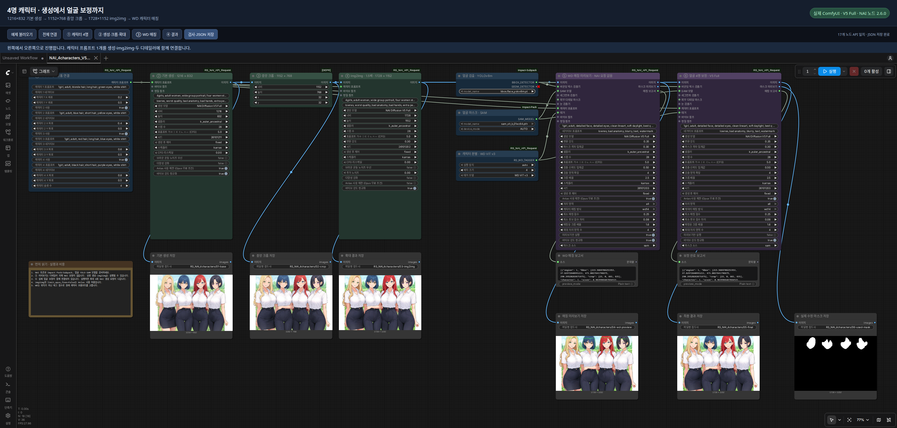

# ComfyUI_RS_NAI_API_Request

ComfyUI custom nodes for **NovelAI Diffusion V5 and earlier models**, supporting text-to-image generation, img2img, inpainting, Vibe Transfer, Precise Reference, multi-character prompts, and prompt-weight conversion. Reference features require a supported model as listed below.

The Detailer can use bbox+SAM, native SEGM masks, or a standard ComfyUI `MASK` from SAM3 or another mask node, and can process multiple regions sequentially. An optional **local PyTorch tagger** automatically matches each region to an original character prompt, preserving its character and series names. Tagger output is used only for matching and is never added to the generation prompt. The tagger requires no ONNX runtime and downloads only the selected model when the loader executes, after the optional dependencies are installed.

> Current version: **2.9.1**

**Development candidate:** [NAI Camera Control / RS Camera Control](docs/camera-control.md) adds smoothly blended camera captions to shared RS/NAI contexts, with an interactive view/weight editor. It supports random views and optional region zoom, rotation and flat-plane perspective. NAI receives view captions and transformed character centers; silhouettes are preserved for local round trips. It does not enforce a 3D camera.

**개발 후보 기능:** [NAI 카메라 시점 / RS 카메라 시점](docs/camera-control.md)은 NAI·로컬 공통 컨텍스트에 시점 태그를 더합니다. 노드 안에서 방향·높이·거리·랜덤 구도와 가중치 곡선을 조절하고, 영역의 확대·축소·회전·평면 원근 변형을 선택합니다. NAI에는 시점 태그와 변환한 캐릭터 중심 좌표를 보내고 실루엣은 로컬 왕복용으로 보존합니다.

## What's New in 2.9.1

Maintenance release: faster mask repair, fewer metadata reads, and clearer error guidance while preserving saved-workflow compatibility.

- **Detailer mask processing:** repair each connected piece within its own bounds and release unused intermediate masks. This reduces work on fragmented masks and memory use when processing multiple regions.
- **Image loader:** avoid duplicate metadata reads when reopening a saved workflow. Changing the image or source model cancels the previous read; removing the node cancels pending reads. Late responses cannot replace the current image's information.
- **Clearer crop errors:** when a detailer crop covers the whole source image, the message explains how to adjust `crop_factor` or choose a smaller-region detector. It no longer recommends the removed Multi-Character Detailer preview control.
- **Cleanup and compatibility:** remove unused PNG save helpers. Existing Face Detailer and converter nodes, old metadata support, and prototype node-ID aliases remain available for saved workflows. The old prototype preview flag does not suppress correction in the Multi-Character Detailer; see [workflow migration](docs/multi-character-detailer.md).

Validation compared masks and reports against 2.9.0 across **180 conditions**, with identical results. In a synthetic 1152×768 mask containing a face and 600 scattered points, median repair time fell from **475.4 ms to 27.9 ms** over three warmed runs. This measures local mask repair, not total generation time. An isolated ComfyUI also restored a five-character V5 Full context from WebP and displayed the image. No new NovelAI generation or Anlas spending was involved in this maintenance validation.

**한국어:** 2.9.1 유지보수 업데이트입니다. 잘게 나뉜 마스크의 보정 연산과 메모리 사용을 줄이고, 저장한 워크플로를 열 때 이미지 로더가 메타데이터를 중복으로 읽던 문제를 수정했습니다. 이미지·모델 변경이나 노드 삭제 시 이전 읽기를 취소하며, 크롭 오류에는 현재 사용할 수 있는 해결 방법을 안내합니다. 사용하지 않는 PNG 저장 보조 함수는 제거했고, 기존 노드·옛 메타데이터·시험 노드 ID 호환은 유지합니다. 멀티 캐릭터 디테일러는 옛 시험 노드 ID로 불러와도 실행하면 보정하며, 예전 미리보기 설정으로 보정을 건너뛰지 않습니다. 마스크와 보고값은 180개 비교 조건에서 일치했고, 이번 검증의 새 NAI 생성 요청·Anlas 사용은 없습니다.

**日本語:** 2.9.1のメンテナンス更新です。細かく分かれたマスクの補正処理とメモリ使用を減らし、保存済みワークフローを開いた際のメタデータの二重読み込みを修正しました。画像・モデルの変更やノード削除時には前の読み込みをキャンセルし、切り抜きエラーでは現在利用できる対処方法を案内します。未使用のPNG保存補助関数を削除し、既存ノード・旧メタデータ・試験版ノードIDの互換性は維持します。マルチキャラクターディテーラーは旧試験版IDでも実行時に補正し、以前のプレビュー設定で補正をスキップしません。180条件の比較でマスクとレポート値が一致し、今回の検証で新たなNAI生成リクエスト・Anlas消費はありません。

## What's New in 2.9.0

**NAI Load Image → NAI context → T2I / I2I / Multi-Character Detailer** restores prompts, character positions and generation settings from PNG/WebP. Unknown models require explicit selection; incomplete context is explained and blocks enabled consumers before requests. Seed and dimensions stay local to each consumer. Selective overrides change only checked fields. [English / 한국어 / 日本語](docs/image-metadata.md)

**Local multi-character interoperability:** update RS NAI API Request and RS Multi-Character Sampler together. NAI T2I, I2I and Load Image expose the shared `RS_MC_CHARACTER_PIPE` output for the local sampler/detailer. NAI character inputs also accept native local pipes and legacy `LIST` connections. Inline/nested local weights convert to NAI syntax; NAI negative-weight text moves to the corresponding local negative caption with its magnitude removed. Local generation merges character negatives into the common negative branch, while detailing uses each matched character's own negative.

Both image loaders show a notice before queueing when an image contains more than 10 characters. The local consumer uses the first 10; the NAI consumer uses its effective model limit (including inpainting fallbacks). Source pipes and source images stay intact. Local PNG/WebP captions can return through NAI Load Image's `character_pipe`; local model/sampler settings do not become `NAI_CONTEXT`. For local input connect the pipe, choose NAI settings manually, and leave `nai_context` disconnected. Local boxes/masks/LoRAs/text-region controls remain local. Face-only detailer records and inset canvas coordinates are not restored as whole-image character positions.

**Applied NAI settings:** after a successful generation, each requesting node shows a read-only summary of the final HTTP request in English, Korean or Japanese. It reflects context overrides, model character limits, Medium fixed settings, Opus size/step limits and inpainting model fallbacks. Strength/noise and reference counts appear only when included. Multi-region runs show the successful request count and the last request's settings; Vibe encoding is excluded. The summary is labeled as the last successful request and is not saved as a workflow input.

**한국어:** 캐릭터 입력을 연결하면 NAI에서 사용하는 프롬프트·네거티브·중심 좌표와 모델별 인원 제한을 안내합니다. 실행 후 **마지막으로 성공한 NAI 요청**에 실제 모델·해상도·시드·샘플링 설정·캐릭터 수를 표시합니다. Medium 고정 설정과 인페인팅 모델 전환도 반영하며, 강도·노이즈·참조 수는 요청에 포함된 경우에만 표시합니다. 여러 영역을 보정하면 성공한 요청 횟수와 마지막 요청의 설정을 보여줍니다.

**Detailer panel:** the multi-character detailer now groups its controls into five in-node tabs: Correction, Regions & masks, Character matching, Generation, and Save & results. Inherited/connected fields show their source; selective overrides reveal an editor beside each field. Workflow values and connections are preserved. [Panel guide / 패널 사용법 / パネルの使い方](docs/multi-character-detailer.md#in-node-panel--노드-내부-패널--ノード内パネル)

**Consistent node panels:** T2I, I2I, inpaint and reference-inset generation use Generation / Prompts / Sampling / Save & results tabs. Legacy face/SEGM detailers share the same panel styling. Detection loaders, taggers, references, inset preparation and asset saving use compact cards. Existing image upload/preview and character-position editors remain available. Medium's fixed sampling/negative values are read-only hints; switching models restores the saved manual values. [Panel controls and validation](docs/node-panels.md)

**한국어:** 생성·I2I·인페인트와 기존 얼굴 디테일러도 같은 내부 패널로 정리했습니다. 감지 모델·태거·레퍼런스·인셋 준비·에셋 저장은 작은 카드로 표시합니다. 상속값·연결값의 출처와 Medium 고정값을 안내하고, 탭을 바꿔도 기존 설정과 연결을 유지합니다.

- **Selective settings in T2I, I2I and the multi-character detailer:** enable context, choose `override_selected`, then turn on only the fields to replace. T2I/I2I forward the effective settings. [Available controls](docs/multi-character-detailer.md#selective-context-settings)
- **Detailer metadata:** autosave preserves the connected whole-image context separately from each region's actual inpainting request. Reload PNG or either WebP format to reuse the full character list, including when correction used manual settings.
- **Compatibility and cache:** existing IMAGE/MASK output positions and generation input order are preserved. Repeated loads reuse the ComfyUI cache when the image and source-model selection have not changed.

**한국어:** 이미지 로더의 **NAI 컨텍스트** 출력을 연결하면 공통·캐릭터 프롬프트와 생성 설정을 이어받습니다. T2I·I2I·멀티 캐릭터 디테일러에서 **선택 항목만 변경**으로 원하는 값만 바꿀 수 있고, 시드·크기는 각 노드 값을 사용합니다. 디테일러 자동 저장에는 원본 전체 컨텍스트와 얼굴별 보정 이력이 구분되어 남습니다.

**日本語:** 画像ローダーの **NAIコンテキスト**出力でプロンプト・キャラクター・生成設定を引き継ぎ、T2I・I2I・マルチキャラクターディテーラーの **「選択項目のみ変更」** で必要な値だけ変更できます。シード・サイズは各ノードの値を使用します。ディテーラーの自動保存では画像全体の元コンテキストと領域ごとの補正履歴を分けて保持します。

## Shared context with RS MultiCharacter

**RS MultiCharacter interoperability:** connect character/context pipes, detection combine loaders and WD taggers between the two updated extensions. Prompts and coordinates transfer; local-only features and each backend's settings survive round trips. NAI payment protection remains local to each node. [Behavior, limits and offline verification](docs/shared-local-context.md).

**한국어:** 양쪽 확장을 업데이트하면 캐릭터·컨텍스트 파이프와 감지기·태거를 서로 연결할 수 있습니다. 프롬프트·좌표를 공유하고 로컬 마스크·LoRA와 양쪽 생성 설정은 왕복할 때 보존합니다. NAI 과금 보호는 각 노드의 설정을 따릅니다.

**日本語:** 両方を更新すると、キャラクター・コンテキストパイプと検出ローダー・タガーを相互接続できます。ローカル専用機能と各バックエンドの設定は往復時に保持され、NAIの課金保護は各ノードの設定に従います。

## What's New in 2.8.0

- **NAI Multi-Character Detailer:** detect regions, match each to its original character prompt and correct it with NovelAI. Hole/notch filling and mask expansion are enabled by default. Execution performs correction; there is no preview-only switch. The resulting image, mask visualization and matching report remain available.
- **NAI Detection Combine Loader:** select SEGM, BBOX and SAM on one loader. SEGM takes priority and skips BBOX/SAM. OFF models are never loaded. Active catalog detectors download on first execution with visible progress; additional weights appear from the existing model folders.
- **Generation context:** connect T2I `image` + `nai_context` → I2I → detailer. Prompts, characters and effective sampling settings carry through; each stage keeps its own seed. Bypassing I2I forwards both connections. Context OFF uses manual settings and still performs correction.
- **Up to 22 characters / 64 regions. Quality cannot be guaranteed as the number of processed regions increases.** The default maximum is five regions; uncertain character matches are skipped.
- Prototype workflows migrate automatically, preserving later widget values and connections. The removed preview setting no longer suppresses correction. Review Anlas protection before running: it remains local to each node, and strict protection blocks potentially paid inpainting.

**[Usage / 사용법 / 使い方](docs/multi-character-detailer.md)** · **[Normal context workflow](examples/multi-character-detailer/NAI_context_normal.json)** · **[I2I bypass workflow](examples/multi-character-detailer/NAI_context_I2I_bypass.json)**

**한국어:** **NAI 멀티 캐릭터 디테일러**는 실행하면 바로 감지·매칭·보정합니다. **미리보기만 실행은 제거**했습니다. 생성 노드에서 이미지와 NAI 컨텍스트를 함께 연결하고, 디테일러에 감지 모델 콤바인 로더와 태거를 연결하세요. 시드는 단계마다 독립이며 I2I 바이패스도 지원합니다. **처리수가 많을수록 품질을 보장하지 못합니다.** 예제는 Anlas 보호가 켜져 있어, 실제 I2I/보정을 하려면 해당 노드에서 보호 설정을 검토해야 합니다.

**日本語:** **NAIマルチキャラクターディテーラー**は実行時に検出・照合・補正を行います。「プレビューのみ」は削除しました。生成ノードの画像とNAIコンテキストを接続し、ディテーラーへ検出モデル結合ローダーとタガーを接続してください。シードは各段階で独立し、I2IのBypassにも対応します。**処理領域数が増えるほど品質は保証できません。** サンプルはAnlas保護が有効です。I2I・補正の実行前に各ノードの保護設定を確認してください。

## What's New in 2.7.1

- **Request delay (seconds):** set `request_delay_seconds` directly on generation, img2img, inpainting, both detailers and inset generation. The default **0** keeps existing pacing; **5** waits at least five seconds before each request. No separate delay node is needed.
- The timer starts when a prepared request reaches its turn in this ComfyUI process. The existing two-second gap runs concurrently (5 seconds does not become 7); longer server `Retry-After` waits still apply. Detailers wait for every region actually sent, and uncached Vibe encoding requests also wait. Local preparation, previews, skipped regions and cached nodes do not trigger a countdown.
- A live countdown appears on the node in English, Korean or Japanese. **Stop** cancels the wait before a request is sent. This option does not change Anlas protection or guarantee that NovelAI will avoid rate limits when other clients also send requests.

**한국어:** 생성 노드의 **요청 전 대기 시간(초)**을 설정하면 됩니다. 기본은 **0초**, **5초**면 각 요청을 보내기 전에 5초 기다립니다. 디테일러는 실제로 요청하는 얼굴마다 적용하며, 미리보기나 건너뛴 영역은 기다리지 않습니다. 노드에 남은 시간이 표시되고 **중지**로 취소할 수 있습니다. 기본 2초 간격과 겹쳐 계산하므로 5초 설정이 7초가 되지는 않습니다.

**日本語:** 生成ノードの**リクエスト前の待機時間（秒）**を設定します。既定は**0秒**、**5秒**なら各リクエストの送信前に5秒待機します。ディテーラーでは実際に送信する領域ごとに適用し、プレビューやスキップした領域では待機しません。ノードに残り時間を表示し、**停止**でキャンセルできます。既定の2秒間隔と同時に計算するため、5秒の設定が7秒になることはありません。

## What's New in 2.7.0

- **Autosave format:** choose PNG, WebP lossless (exact pixels), or WebP lossy (quality 1–100) directly on generation, img2img, inpainting, detailer and inset nodes. Existing workflows default to PNG. No separate save node or metadata connection is needed.
- **NAI Load Image:** select/upload a PNG or WebP and inspect its NovelAI prompts, per-character negative prompts/positions and generation settings immediately inside the node. Copy text or apply supported settings to a chosen generation node; editable character inputs are connected automatically. IMAGE and MASK outputs work like ComfyUI Load Image.
- NovelAI PNG text, WebP EXIF and compressed alpha metadata are supported. Autosaves preserve the NAI information and effective request settings, including the selected model. **No ComfyUI workflow is embedded**; use the standard Save Image node if you want a workflow in the image.
- Detailer saves now keep a history of each face request. The loader does not mistake the final face's prompt for the whole image. Unknown models, unavailable source/reference images and settings that cannot be applied exactly are explained.
- English, Korean and Japanese UI. [Usage and restoration limits / 사용법 / 使い方](docs/image-metadata.md).

**한국어:** 생성 노드에서 **저장 형식**만 선택하면 자동 저장됩니다. **NAI 이미지 불러오기**에서 파일을 선택하면 바로 생성 정보를 확인하고, **적용할 노드 → 설정 적용**으로 옮길 수 있습니다. 워크플로는 저장하지 않습니다.

**日本語:** 生成ノードで**保存形式**を選ぶと自動保存されます。**NAI画像を読み込む**でファイルを選択すると生成情報が表示され、**適用先 → 設定を適用**で転記できます。ワークフローは埋め込みません。

## Four-character walkthrough / 캐릭터 4명 실전 가이드 / 4人の実践ガイド

**[English guide](examples/four-character-v5-wd/README.en.md) · [한국어 가이드](examples/four-character-v5-wd/README.md) · [日本語ガイド](examples/four-character-v5-wd/README.ja.md)** · [아카라이브 게시글 / Korean community post](https://arca.live/b/aiart/185683009)

A tested V5 Full workflow: **generate four characters at 1216×832 → crop to 1152×768 → 1.5× img2img at 1728×1152 → match and detail four faces with WD ViT v3**. Includes real ComfyUI screenshots, output images, setup instructions, and troubleshooting.

| Start here | Workflow PNG | Workflow JSON |
|---|---|---|
| Check character matching first / 매칭 먼저 확인 | [Preview PNG](examples/four-character-v5-wd/NAI_4characters_V5_WD_preview.png?raw=true) | [Preview JSON](examples/four-character-v5-wd/NAI_4characters_V5_WD_preview.json?raw=true) |
| Run through face correction / 얼굴 보정까지 실행 | [Full PNG](examples/four-character-v5-wd/NAI_4characters_V5_WD.png?raw=true) | [Full JSON](examples/four-character-v5-wd/NAI_4characters_V5_WD.json?raw=true) |

Save the **original file** (GitHub: **Download raw file**) and drag it into ComfyUI. Both PNGs contain ComfyUI workflow metadata. The preview workflow also runs upstream generation/img2img and can spend Anlas; the full workflow proceeds through correction without pausing for preview approval. See the guide for dependencies and cost settings.

**한국어:** PNG 원본을 저장해서 ComfyUI에 끌어다 놓으면 됩니다. 매칭 확인용도 앞 단계의 생성·img2img 비용이 들 수 있으니 가이드의 준비 항목과 비용 설정을 먼저 확인하세요.

**日本語:** PNGの元ファイルを保存してComfyUIにドラッグ＆ドロップしてください。マッチング確認用も前段の生成・img2imgでAnlasを消費する場合があるため、先にガイドの準備と料金設定を確認してください。

For the offline HTML guide with image zoom and before/after comparison, download and extract the repository ZIP, then open `index.en.html` (English), `index.html` (한국어), or `index.ja.html` (日本語) in `examples/four-character-v5-wd/`. Screenshots and shared workflows use Korean custom node titles; both translations include a node-name reference table.

[](examples/four-character-v5-wd/README.md)

## What's New in 2.6.1

- Updated the package description used by Comfy Registry to reflect current generation, character matching, mask, reference, asset, and prompt conversion features. This release updates metadata only; node behavior and dependencies are unchanged.

## What's New in 2.6.0

- Both Detailers accept three mask backends: the existing detector-box-to-SAM path, a `SEGM_DETECTOR`'s native `cropped_mask`, or a standard `MASK` from SAM3/another mask node.
- `sam_model` is optional. `NAI Face Detailer` also makes `bbox_detector` optional, so a same-size external MASK can define regions without loading legacy SAM. The `Detailer` node keeps its required SEGM detector for existing workflows.
- `mask_source=auto` preserves the previous SAM behavior whenever a complete detector+SAM path is connected. Otherwise it selects `detail_mask`, then native SEGM masks. Choose `sam`, `segm`, or `external_mask` to override that rule explicitly.
- A MASK batch creates one detail region per nonempty batch item. Disconnected shapes within one batch item stay one region and share one crop/prompt assignment; split them into a mask batch when they need separate regions or character matching.
- Native masks preserve their own pixels; only actual overlaps are divided between regions. Their preview shows the exact final composite mask. Empty SAM3 batches return the original image without a request, and existing positional workflow settings keep their order. See the [SAM3 / SEGM guide](docs/sam3-segm-masks.md).
- Native SEGM/external masks appear in `preview_only` without token access, legacy SAM execution, or a NovelAI request. Existing Vibe Transfer, Precise Reference, Focused Inpainting checks, output positions, and bbox+SAM results remain unchanged.

## What's New in 2.5.0

- **Reference Inset** prepares a reference canvas and generation mask locally. Choose left/right/top/bottom and the reference percentage; the node shows both canvas and cropped output dimensions and previews the canvas when executed.
- **Reference Inset Generate** fills the empty area with NovelAI inpainting, adds `reference inset` once, and returns the cropped image, preserved full canvas, and applied prompt. Both images are autosaved. Default Anlas protection blocks generation; preparation remains local.
- **Character Asset Save / Load** keep one reference image and its original positive/negative character prompts in a portable PNG. Save locally, refresh the loader list, and reuse the image and prompts in other workflows.
- New nodes have Korean/Japanese native labels, tooltips, and friendly error messages. Existing node inputs and workflow defaults are unchanged. See the [reference inset and asset guide](docs/reference-inset.md).

## What's New in 2.4.6

- Execution errors now explain **what failed and what to do next**, in English, Korean, or Japanese according to ComfyUI's language setting. The explanation appears in the error dialog and directly on the failed node. Refresh the browser after updating.
- Distinct messages cover API authentication/status codes, timeouts and connection failures, strict Anlas protection, model/character/reference combinations, image/mask inputs, tagger dependencies/downloads, memory, and file access. Unknown failures retain their actual error type and details without guessing the cause.
- Stable error codes, HTTP status, request stage, and original traceback remain available for troubleshooting. Common token patterns are masked. Explanations do not change request/retry rules or billing protection, and cancellation remains cancellation.
- Error widgets clear when the node executes again and are excluded from saved workflow inputs. See [error messages and troubleshooting](docs/error-messages.md) for examples and scope.

**한국어:** 오류창과 실패한 노드에 원인·해결 방법을 표시합니다. 아래 상세 정보에는 오류 코드, HTTP 상태, 실패 단계와 원래 오류가 남습니다. ComfyUI 언어 설정을 따라가며 알 수 없는 원인은 단정하지 않습니다.

**日本語:** エラーダイアログと失敗したノードに原因と対処方法を表示します。エラーコード、HTTP ステータス、失敗した段階、元のエラーは詳細情報に残ります。ComfyUI の言語設定に従い、不明な原因を推測して断定しません。

## What's New in 2.4.5

- **Expandable character slots**: `character_count` shows 1–22 slots, with the familiar 5-slot view as the default. Increase it to add characters; decrease it to hide and exclude the later slots. Their text and coordinates are kept when saved and reopened. Existing five-slot workflows retain their input order and defaults.
- **Model limits**: V5 supports up to 22 active character prompts; V4/V4.5 supports 6. V5 Curated inpainting uses V4.5 Curated, so its limit is also 6. Excess prompts produce a local error before image/reference encoding or an API request; nothing is silently dropped. See the [official multi-character documentation](https://docs.novelai.net/en/image/multiplecharacters/).
- Both face detailers can match against all 22 original character candidates. `detail_mode` and `max_regions` still control how many detected regions are processed (`first` by default; `all` with up to 64 regions). The slot limit is not a guarantee of multi-character recognition accuracy. Use `preview_only` to inspect uncertain matches without generation.
- Korean and Japanese labels and tooltips include the new slots and count control. Refresh the ComfyUI page after updating.

## What's New in 2.4.4

- Added Korean and Japanese translations for all 15 nodes through [ComfyUI's native locale files](https://docs.comfy.org/custom-nodes/i18n): names, descriptions, input labels, tooltips, named outputs, and reference/detailer options. Socket type names and the display of option values follow ComfyUI's own locale handling.
- Choose **한국어** or **日本語** in **ComfyUI Settings → Comfy → Locale → Language**. After updating the extension, restart ComfyUI and refresh the browser to load the new translations.
- Node IDs, saved input values, model names, sampler identifiers, and generation prompts remain unchanged. Other languages continue to use the existing English node definitions. Runtime notices, download status messages, and matching reports remain in English; execution error explanations are localized as of 2.4.6.

**한국어:** ComfyUI 설정에서 언어를 **한국어**로 선택하면 노드 이름·설명·입출력 항목·툴팁이 한국어로 표시됩니다. 업데이트 후에는 ComfyUI를 재시작하고 브라우저를 새로고침하세요.

**日本語:** ComfyUIの設定で言語を**日本語**にすると、ノード名・説明・入出力ラベル・ツールチップが日本語で表示されます。更新後はComfyUIを再起動し、ブラウザーを再読み込みしてください。

## What's New in 2.4.3

- Choose a local tagger model in the existing `NAI WD Tagger Loader (PyTorch)` node's `model_name` menu. Existing workflows keep WD ViT v3 as their default.
- Only the selected model downloads when the loader executes. Each model has its own pinned HuggingFace cache; switching models replaces the loader's active model.
- Download progress appears directly on the loader node: current filename, percentage and received/total MiB, followed by loading and ready states. Cached files are reused.
- Each model uses its own preprocessing. General/character scores feed the existing matcher; unrelated prediction categories are excluded. Larger models need additional dependencies and memory; start with `batch_size=1`.

## What's New in 2.4.2

- Reviewed every published Comfy.ICU node page against the current implementation. The [page-by-page audit](docs/node-page-audit.md) distinguishes fixes from outdated external descriptions.
- WD Tagger Loader checks optional dependencies as soon as it executes. Missing/broken imports include the actual ComfyUI Python installation command. Version 2.4.2 loaded weights on the first match; 2.4.3 prepares them in the loader with visible download progress.
- Execution notices appear on the node for malformed/downgraded prompt weights, obsolete coordinates, Opus dimension/step changes, Medium fixed settings and detailer skips. Notices are read-only and are not saved as workflow inputs; existing input order/defaults and output sockets are preserved.
- V3/Furry generation rejects connected character slots before reading the token or preparing references. Unknown models no longer silently select a different model. Detailers can still match a character and use its original text in a V3 base prompt.
- Img2img, inpaint and detailers reject image batches instead of silently using the first image. Inpaint validates a single nonempty mask and warns about differing source/mask dimensions.
- Autosave names are unique even within the same timestamp. ZIP responses select the sole PNG regardless of metadata/directory order, and reject missing or multiple images.
- Detailer reports explain score/margin skips and request limits, including the latest tighter-crop result. API masks and disjoint compositing are unchanged.

Reload the ComfyUI browser page after updating to load the notice widget. It appears after execution when there is something to report. For old 0–10 coordinate workflows, update the original saved values to 0–1; ambiguous values are not automatically migrated.

## What's New in 2.4.1

- Unified the previously separate Linux integration into `main`. Windows and Linux now use the same package, including V5 Full Medium Effort, Vibe Transfer, Precise Reference, and Face Detailer Focused Inpainting.
- Added **NAI Vibe Transfer** and **NAI Precise Reference** nodes, optional reference inputs on generation and detailer nodes, and local caching for V4/V4.5 Vibe encodings.
- Allowed the detailer's internally produced Focused Inpainting crops in `limit_opus_free` mode, with crop, payload, subscription, and V5 allowance checks. General img2img/inpainting and both reference features remain blocked in strict mode.
- Preserved the Medium settings and inpainting strength fix from 2.3.1. Existing node names, inputs, defaults, and outputs are retained; reference inputs are appended as optional connections.

See [Vibe Transfer and Precise Reference](#vibe-transfer-and-precise-reference) for setup, supported models, costs, and example API workflows. See [Medium Effort compatibility and validation](docs/medium-effort.md) for Medium settings and verification scope.

## What's New in 2.3.1

- Fixed inpainting strength for V4/V4.5/V5, including Medium Effort and both face detailers. Partial strength now reaches the API as `img2img.strength` with color correction, matching the NovelAI web client. A strength of 1 uses full inpainting without that option.
- Added a model tooltip explaining Medium's fixed settings and when image input can spend Anlas, without changing saved workflow input positions.
- Expanded tests across generation, img2img, inpainting, multi-region detailing, output decoding/autosave, and Medium's checks before network requests.

## What's New in 2.3.0

- Added **NAI Diffusion V5 Full — Medium Effort** for generation, img2img, and inpainting.
- Medium Effort uses NovelAI's distilled checkpoints and always sends 14 steps, Euler Ancestral, zero CFG Rescale, and the fixed Heavy Undesired Content preset. The node ignores the steps, sampler, CFG Rescale, base negative prompt, and character negative prompts shown in an existing workflow while this model is selected.
- Medium Effort img2img and general inpainting remain blocked when `limit_opus_free=True`, because those modes can spend Anlas.
- `limit_opus_free=True` recognizes Medium text generation, still verifies the V5 Opus allowance, and rejects a payload whose fixed Medium settings were changed before transport.

## What's New in 2.2.1

- Character X/Y inputs now use **0.0–1.0 in 0.1 increments**, rounded to one decimal place and sent directly as normalized coordinates.
- Default positions are unchanged (for example, the old `3` is now `0.3`). When loading an older workflow, update saved coordinate values to the new range (`5` becomes `0.5`, `10` becomes `1.0`); the old 0–10 input scale is no longer used.

## What's New in 2.2.0

- Added `detail_mode=all` for sequential detailing of multiple detected regions; existing workflows keep the `first` default.
- Added automatic matching to original character prompts with the optional native PyTorch WD tagger. Tagger output is used only for matching and never added to generation prompts.
- Preserved the original API mask grid while compositing each region through its own mask.
- Serialized NovelAI requests with a minimum two-second delay after each HTTP attempt completes.
- Validated two-face processing with a real ComfyUI/YOLO/SAM/WD/NovelAI run and 39 regression tests. Exact four-eye detection and reliable expression preservation remain outside the verified coverage.

## What's New in 2.1.1

- Added NovelAI Diffusion V5 Curated and V5 Full model selection.
- V5 requests use `params_version: 4` while older models keep `params_version: 3`.
- V5 continues to use NovelAI's `v4_prompt` / `v4_negative_prompt` conditioning structure, including character prompts.
- V5 Full uses native V5 inpainting. V5 Curated follows NovelAI's current client fallback to V4.5 Curated inpainting.
- Autosaves are written under `output/<date>/NAI_autosave/`. A newly created nested folder may require refreshing the file browser or image feed before its first image appears in the listing.

## Features

- **Reference inset**: Automatic canvas/mask preparation, output-size preview, reference-guided inpainting, and exact result cropping.
- **Character assets**: Portable reference PNGs with original prompts, a local save/load library, and an in-node refresh button.
- **Image references**: Vibe Transfer for supported V3/V4/V4.5 models, plus V4.5 Precise Reference for character and style guidance.
- **NovelAI generation**: Text-to-image, img2img, and inpainting with NAI Diffusion V5, V4.5, V4, V3, and supported Furry models.
- **Multi-character prompts**: Up to 22 character slots for V5 (6 for V4/V4.5), with separate positive/negative prompts and X/Y coordinates from 0.0 to 1.0 in 0.1 increments.
- **Multiple-region detailing**: YOLO detection, SAM masks, and sequential NAI inpainting, with masked compositing for overlapping crops. Select `detail_mode=all` to process multiple regions.
- **Automatic character matching**: An optional native PyTorch WD tagger selects the original character prompt for each region. Unclear matches are retried with a tighter crop and skipped if still ambiguous.
- **Controlled API requests**: Requests run sequentially, with at least two seconds after each HTTP attempt completes before the next begins.
- **Prompt-weight conversion**: Utilities for converting prompt-weight syntax between supported local formats and NovelAI.

## Installation

### Method 1: ComfyUI Manager (Recommended)
1. Open ComfyUI.
2. Click on **Manager** -> **Custom Nodes Manager**.
3. Search for `ComfyUI_RS_NAI_API_Request`.
4. Click **Install**.

### Method 2: Manual Installation
1. Navigate to your ComfyUI `custom_nodes` directory.
2. Clone this repository:
   ```bash
   git clone https://github.com/raspie10032/ComfyUI_RS_NAI_API_Request.git
   cd ComfyUI_RS_NAI_API_Request
   ```
3. Install dependencies:
   ```bash
   python -m pip install -r requirements.txt
   ```

## Configuration (API Token)

Generation requires your **NovelAI API Token**. Converters, character/reference builders, and WD matching/preview run without a NovelAI token. WD model files may be downloaded from HuggingFace on first use.

1. Create a `.env` file in the root of this custom node directory (`ComfyUI_RS_NAI_API_Request/.env`).
2. Add your token to the file using the canonical variable name:
   ```text
   NAI_ACCESS_TOKEN=your_api_token_here
   ```
   `NAI_API_TOKEN` is also accepted as a fallback for compatibility, but `NAI_ACCESS_TOKEN` is recommended.

Alternatively, you can set either variable as a system environment variable (`NAI_ACCESS_TOKEN` is checked first; `NAI_API_TOKEN` is checked if the first is absent).

## Nodes

### 1. NAI Image Generator (`NovelAIGenerator`)
Main node for text-to-image generation.

| Parameter | Type | Description |
| :--- | :--- | :--- |
| `prompt` | STRING | The main positive prompt. |
| `negative_prompt` | STRING | The main negative prompt. |
| `model` | LIST | NAI Model (V5, V4.5, V4, V3, etc.). |
| `width` / `height` | INT | Image dimensions (steps of 64). |
| `sampler` | LIST | Sampler (e.g., k_euler, k_dpmpp_2m). |
| `steps` | INT | Generation steps (1-50). |
| `cfg_scale` | FLOAT | Guidance scale. |
| `seed` | INT | Random seed (-1 for random). |
| `scheduler` | LIST (Optional) | Noise scheduler: `native`, `karras`, `exponential`, `polyexponential`. |
| `cfg_rescale` | FLOAT (Optional) | Prompt guidance rescale (0.0–1.0). |
| `prefer_brownian` | BOOLEAN (Optional) | Use brownian noise in sampler. |
| `variety_boost` | BOOLEAN (Optional) | Enable `skip_cfg_above_sigma` for more varied outputs (V4/V4.5). |
| `characterPrompts` | LIST (Optional) | Per-character prompts from `CharacterPromptSelect` (V4+ only). |
| `limit_opus_free` | BOOLEAN (Optional) | Require an active Opus subscription and Anlas-free text generation conditions; check V5 allowance before each request. Default: `True`. |

### 2. NAI Character Prompt Select (`CharacterPromptSelect`)
Defines up to 22 characters with spatial coordinates (0.0–1.0 scale). Start with the default five slots and increase `character_count` as needed. V4/V4.5 accept 6 active prompts; V5 accepts 22 (except V5 Curated inpainting: 6). Newly revealed slots 6–22 are enabled; fill them in or turn off their individual switch. Slots outside the count are excluded even if their switches are on.

**Changing the slot count does not rewrite the common prompt.** When changing a five-person example to three people, also change `5girls` to `3girls`, `five women` to `three women`, and `all five faces visible` to `all three faces visible`. Otherwise the scene still asks for five people even though only three character prompts reach NAI and the context output. Execution notices show when stored slots are excluded and when simple numeric person-count tags disagree with the active character prompts. These are hints, not generation errors: crowd scenes and repeated characters can intentionally have different counts. Natural-language counts are not automatically interpreted or edited.

| Parameter | Type | Description |
| :--- | :--- | :--- |
| `character_count` | INT | Visible/usable slots, 1–22; default 5. Hidden values are preserved. |
| `characterX` | STRING | Character specific prompt. |
| `characterX_uc` | STRING | Character specific negative prompt. |
| `characterX_x` / `y` | FLOAT | Center coordinates (0.0–1.0, step 0.1, one decimal place). |
| `characterX_enable`| BOOLEAN| Enable/Disable specific character slot. |

### 3. NAI Img2Img (`NAIImg2ImgNode`)
Performs image-to-image generation.

| Parameter | Type | Description |
| :--- | :--- | :--- |
| `image` | IMAGE | Source image. |
| `prompt` / `negative_prompt` | STRING | Positive / negative prompts. |
| `model` | LIST | NAI model selection. |
| `width` / `height` | INT | Output dimensions (steps of 64). |
| `sampler` | LIST | Sampler algorithm. |
| `steps` | INT | Generation steps (1–50). |
| `cfg_scale` | FLOAT | Guidance scale. |
| `strength` | FLOAT | Denoising strength (0.0–1.0). |
| `seed` | INT | Random seed (-1 for random). |
| `scheduler` | LIST (Optional) | Noise scheduler: `native`, `karras`, `exponential`, `polyexponential`. |
| `cfg_rescale` | FLOAT (Optional) | Prompt guidance rescale (0.0–1.0). |
| `prefer_brownian` | BOOLEAN (Optional) | Use brownian noise in sampler. |
| `noise` | FLOAT (Optional) | Extra noise added before sampling (0.0–1.0). |
| `variety_boost` | BOOLEAN (Optional) | Enable `skip_cfg_above_sigma` for more varied outputs (V4/V4.5). |
| `characterPrompts` | LIST (Optional) | Per-character prompts from `CharacterPromptSelect` (V4+ only). |
| `limit_opus_free` | BOOLEAN (Optional) | Blocks img2img while `True`, because a base image can cost Anlas. Set `False` to allow the paid request. Default: `True`. |

### 4. NAI Inpaint (`NAIInpaintNode`)
Specialized node for inpainting. Automatically snaps dimensions to 64px.

V5 Full uses its native V5 inpainting model. Until NovelAI releases V5 Curated inpainting, selecting V5 Curated follows the official client and uses V4.5 Curated inpainting.

| Parameter | Type | Description |
| :--- | :--- | :--- |
| `image` | IMAGE | Source image. |
| `mask` | MASK | Area to inpaint (white = repaint). |
| `prompt` / `negative_prompt` | STRING | Positive / negative prompts. |
| `model` | LIST | NAI model selection. |
| `width` / `height` | INT | Output dimensions (snapped to 64px). |
| `sampler` | LIST | Sampler algorithm. |
| `steps` | INT | Generation steps (1–50). |
| `cfg_scale` | FLOAT | Guidance scale. |
| `strength` | FLOAT | Inpainting strength (0.0–1.0). |
| `seed` | INT | Random seed (-1 for random). |
| `scheduler` | LIST (Optional) | Noise scheduler: `native`, `karras`, `exponential`, `polyexponential`. |
| `cfg_rescale` | FLOAT (Optional) | Prompt guidance rescale (0.0–1.0). |
| `prefer_brownian` | BOOLEAN (Optional) | Use brownian noise in sampler. |
| `noise` | FLOAT (Optional) | Extra noise added before sampling (0.0–1.0). |
| `variety_boost` | BOOLEAN (Optional) | Enable `skip_cfg_above_sigma` for more varied outputs (V4/V4.5). |
| `characterPrompts` | LIST (Optional) | Per-character prompts from `CharacterPromptSelect` (V4+ only). |
| `limit_opus_free` | BOOLEAN (Optional) | Blocks inpainting while `True`, including V5 Curated's V4.5 fallback, because a base image can cost Anlas. Set `False` to allow the paid request. Default: `True`. |

### 5. NAI Face Detailer (`NAIFaceDetailerNode`)
Advanced region restoration using bbox+SAM, native SEGM masks, or a standard ComfyUI MASK before sending focused crops to the NAI API.

**Requirement**: Requires [ComfyUI-Impact-Pack](https://github.com/ltdrdata/ComfyUI-Impact-Pack) and [ComfyUI-Impact-Subpack](https://github.com/ltdrdata/ComfyUI-Impact-Subpack) for detectors. BBOX_DETECTOR types are provided by ComfyUI-Impact-Subpack.

**Behavior**: Defaults to the first detected region. With `detail_mode=all`, plans all regions from the original image, assigns character prompts when enabled, and inpaints each region sequentially. Results are composited through masks with disjoint ownership where crops overlap. Native SEGM and external MASK paths preserve all above-threshold pixels belonging to each instance and assign only genuinely overlapping pixels by nearest detection center (stable detection order breaks ties). The crop targets a 1024 px longest side before 64 px dimension alignment. The API mask uses 32 px boxes at an 8 px stride and covers thin native-mask details in whole 8 px cells. Native paths composite only inside the owned source mask; the legacy bbox+SAM path retains its whole-cell request ownership and resized composite mask. This avoids a mask downscale/upscale round trip that produced visible artifacts during live V5 Full testing.

| Parameter | Type | Description |
| :--- | :--- | :--- |
| `image` | IMAGE | Source image. |
| `bbox_detector` | BBOX_DETECTOR (Optional) | YOLO detector (e.g., face_yolov8m.pt). Pair with `sam_model` for the legacy path. |
| `sam_model` | SAM_MODEL (Optional) | Legacy SAM model. In `auto`, a complete detector+SAM path preserves the previous behavior. |
| `prompt` / `negative_prompt` | STRING | Positive / negative prompts for inpainting. |
| `model` | LIST | NAI model selection. |
| `strength` | FLOAT | Inpainting denoising strength (0.0–1.0). |
| `threshold` | FLOAT | SAM grid-box mask threshold. |
| `sampler` | LIST | Sampler algorithm. |
| `steps` | INT | Generation steps (1–50). |
| `cfg_scale` | FLOAT | Guidance scale. |
| `bbox_threshold` | FLOAT | Confidence threshold for YOLO detection. |
| `dilation` | INT | Bbox dilation in pixels. |
| `crop_factor` | FLOAT | Zoom factor around the detected face. |
| `scheduler` | LIST | Noise scheduler. |
| `seed` | INT | Random seed (-1 for random). |
| `segm_detector` | SEGM_DETECTOR (Optional) | Native mask source when SAM is absent or `mask_source=segm`; with bbox+SAM in `auto`, it remains an additional SAM box source for compatibility. |
| `detail_mask` | MASK (Optional) | Same-size standard ComfyUI mask, including SAM3 output. Each nonempty batch item becomes one region. |
| `mask_source` | LIST (Optional) | `auto` preserves a complete SAM path, otherwise chooses external MASK then SEGM. Explicit choices are `sam`, `segm`, and `external_mask`. |
| `eye_bbox_detector` | BBOX_DETECTOR (Optional) | Additional detector for eye area mask refinement. |
| `limit_opus_free` | BOOLEAN (Optional) | Allows only verified Opus Focused Inpainting crops while `True`; full-frame crops stop before token access or transport. Set `False` to allow other paid edits. Default: `True`. |

Face Detailer outputs the composited image, a mask visualization, and a JSON matching report. The existing first two output socket indices are unchanged. If no region is detected, including an empty SAM3 batch, the original image and a black mask preview are returned. For native SEGM/external MASK, `preview_only=True` displays the exact final composite mask and records `mask_pixels` per region, without token access or NovelAI requests. The legacy bbox+SAM preview remains detection/matching-only. See [SAM3 / SEGM setup and mask behavior](docs/sam3-segm-masks.md). Edited results are autosaved under `NAI_autosave/face` with metadata preserved from the NAI inpaint result.

### 5b. Detailer (`NAIFaceDetailerSegmNode`)
Same pipeline as NAI Face Detailer, but `segm_detector` remains the **required** primary detector. With no SAM model, its native `cropped_mask` supplies the editable pixels (threshold and overlap ownership still apply). Connecting `sam_model` with `mask_source=auto` preserves the previous behavior: SEGM boxes guide SAM and optional `bbox_detector` boxes are assigned to those regions. `detail_mask` can instead receive a same-size standard MASK from SAM3 or another node when `mask_source=external_mask`. `eye_bbox_detector` and `limit_opus_free` behave identically to the Face Detailer node. Displayed in ComfyUI as **Detailer**.

### 5c. Multi-Character Detailer and Detection Combine Loader

See the [2.8.0 guide](docs/multi-character-detailer.md) for the combined loader, T2I/I2I context, independent seeds and I2I bypass. The Multi-Character Detailer always corrects eligible regions when executed. The `preview_only` descriptions below apply to the older Face Detailer nodes.

### 5d. Automatic character matching (native PyTorch)

The detailers accept the original `CharacterPromptSelect` output through
`characterPrompts`. Connect `NAI WD Tagger Loader (PyTorch)` to `tagger`, select
`detail_mode=all` and `matching_mode=wd14` to process several characters.
The `wd14` mode and `RS_WD_TAGGER` socket accept all models in the loader's selection menu, preserving existing workflows.

Install the optional dependencies **using the Python environment that runs
ComfyUI**: `python -m pip install -r requirements-tagger.txt`. Reuse its existing
PyTorch/torchvision installation. Additional model dependencies and installation
commands are listed in [the model notes](docs/tagger-models.md). If dependencies
are missing, the loader reports an installation command using the current
ComfyUI Python environment. The loader checks the dependencies for
the selected model before returning a handle. No ONNX package is used. Ordinary generation
and shared-prompt detailing do not import timm or download a tagger.

The loader provides `device=auto` (ComfyUI's selected device) or `cpu`, a batch
size, and `model_name`:

| Selection | Official model | Input | Weight download |
| --- | --- | --- | --- |
| **WD ViT v3** (default) | [SmilingWolf/wd-vit-tagger-v3](https://huggingface.co/SmilingWolf/wd-vit-tagger-v3) | 448 × 448, BGR | About 377 MB |
| **WD EVA02 Large v3** | [SmilingWolf/wd-eva02-large-tagger-v3](https://huggingface.co/SmilingWolf/wd-eva02-large-tagger-v3) | 448 × 448, BGR | About 1.26 GB |

Select a model and execute a workflow using this loader (matching or
`preview_only`) to download it. The loader shows a per-file progress bar, filename,
percentage and received/total MiB, then a loading and ready status. Installing
the node alone does not download weights. Files are cached
under `ComfyUI/models/rs_wd_tagger`, separated by model and pinned revision.
Already downloaded models are reused. Models that require custom architecture
or processor code download it from a pinned, reviewed revision and verify its
SHA-256 before loading. Model-specific requirements, licenses and source links are recorded in
[the model notes](docs/tagger-models.md).

Inference runs locally; image crops are not sent to model hosts. Models
are kept on CPU between calls and offloaded from GPU after tagging, including
failed inference. Larger models need more memory and compute: start with `batch_size=1`.
Initial downloads/model loading and CPU inference take additional time. Tagger
selection, downloads and local inference do not use NovelAI or Anlas.

Models produce different score distributions. The Detailer's existing
`match_min_score` and `match_min_margin` still control acceptance; category
thresholds from captioning examples are not applied before matching. Preview
matches on your own images when switching models. Ambiguous matches remain skipped.

**Tagger scores are used only to select a character. They never become positive
or negative prompt text.** Each request combines the Detailer's user-supplied
shared/stage prompt with the selected original character prompt verbatim, and
combines the corresponding original negatives. Character names, franchise names,
qualifiers and weights remain in that original text even when the tagger does
not know the character. Only that selected character is sent; full-image
character coordinates are not reused for a crop.

Keep the Detailer `prompt` input for shared style/detail-stage instructions.
Keep character identities, their franchise tags and character-specific attributes
in the original character slots. A single flat prompt containing multiple mixed
identities is not automatically split or assigned to characters. Tags should use
Danbooru/NovelAI naming for matching; original strings are preserved for requests.

| Input | Behavior |
|---|---|
| `detail_mode` | `first` preserves detector order; `all` numbers valid regions from left to right, then top to bottom. |
| `matching_mode` | `shared` applies the common prompt (optionally one original character); `wd14` automatically selects among original character slots. Multiple slots require `wd14`. |
| `match_crop_factor` | Context around each primary bbox for matching; independent of the inpaint `crop_factor`. Default 2.0. |
| `match_min_score` | Minimum strongest discriminating tag score, default 0.25. This is a heuristic score, not a calibrated identity probability. |
| `match_min_margin` | Minimum lead over the next character, default 0.08. |
| `max_regions` | Maximum regions considered for API requests, default 16. Unprocessed regions still retain their mask ownership. |
| `preview_only` | Show numbered detections and automatic matches without reading the API token or making NAI requests. Native SEGM/external masks are shown in `mask_visualization`; the legacy SAM path still previews boxes without running SAM. WD inference/download can still occur. |

Matching ignores shared attributes and common scene/quality tags, reduces the
weight of eye color, and uses the strongest distinct evidence without penalizing
longer original prompts. Ambiguous contextual crops are retried once at a tighter
factor (up to 1.25). Still-ambiguous regions are skipped with the source pixels
preserved; there is **no manual mapping input and no forced ordering fallback**.
Multiple regions can belong to the same character, as with separate eye detections.
This is not a one-to-one assignment constraint.

For eye refinement, prefer a face detector as the primary detector and an eye
detector on `eye_bbox_detector`, so identity matching sees the head. Eye-only
primary boxes are supported but may not contain enough identity evidence even
after context expansion. Context that includes another character, similar
identities, and characters absent from the tag vocabulary can remain ambiguous.
There is no automatic semantic grouping of eye pairs into faces in this version.

The JSON `matching_report` records detection boxes, selected original character
slot, match score/margin and planned/edited/skipped/empty-mask status. It contains
no inferred prompt. A final edited PNG preserves the last API response metadata
and adds `rs_detailer_regions` for the multi-region report. The last response's
metadata alone is not a full multi-request workflow record.

### Vibe Transfer and Precise Reference

Connect `Load Image` to either **NAI Vibe Transfer** or **NAI Precise Reference**, then connect its output to the generator's `vibes` or `references` input. The same inputs are available on img2img, inpainting, and both detailer nodes, subject to the compatibility table below. Leave them disconnected for the existing behavior.

Example API graphs: [Vibe Transfer](workflow_example/vibe_transfer_api.json) and [Precise Reference](workflow_example/precise_reference_api.json). Replace `reference.png` with your input filename. They retain the default `limit_opus_free=True`, which blocks reference requests. To run a reference generation after accepting its Anlas cost, explicitly set the generator's `limit_opus_free` input to `False`.

| Feature | Models | Normal generation / img2img | Inpainting / detailing |
| :--- | :--- | :--- | :--- |
| Vibe Transfer | V3 | Supported | Supported |
| Vibe Transfer | V4 / V4.5 | Supported | Not supported |
| Precise Reference | V4.5 Full / Curated | Supported | Supported |
| Either feature | V5, legacy Furry | Not supported | Not supported |

Model capabilities follow the [official NovelAI client](https://novelai.net/image). [Precise Reference](https://docs.novelai.net/en/image/precisereference/) is currently incompatible with Vibe Transfer, so connect one feature at a time. Even when V5 Curated inpainting normally falls back to V4.5 internally, reference use requires selecting V4.5 explicitly.

**NAI Vibe Transfer** accepts one image, `strength` (default 0.6), and `information_extracted` (default 1.0). To combine images, connect one Vibe node's output to the next Vibe node's optional `vibes` input, then connect the final output to the generator. Each node retains its own settings; up to 16 references can be chained. `enabled=false` or strength zero omits that node's image. The V4/V4.5 `normalize_vibe_strengths` option scales strengths down when their absolute sum exceeds 1.0.

V3 sends a prepared image directly. V4/V4.5 first call the Vibe encoder and store the returned encoding in `ComfyUI/models/rs_nai_vibes`. Cache keys include image content, model, and information extracted. Changing strength or the generation seed reuses the encoding; changing image/model/extraction settings requires another encoding. Cache data contains no token. If a cache file is damaged, execution reports the file rather than silently paying to encode it again. The cache is shared within this ComfyUI installation; separate processes have separate request locks.

**NAI Precise Reference** accepts one image, `reference_type` (`character`, `style`, or `character&style`), `strength`, and `fidelity` (both default 1.0). Chain nodes through `references` to combine up to 16 images. Images are fitted without stretching to the closest 1024×1536, 1472×1472, or 1536×1024 canvas, with black padding. Finite negative strength/fidelity values supplied through connected inputs are also forwarded; the default widgets cover 0–1.

Precise references are global generation guidance. Multiple character references **blend identities**, rather than mapping each image to a character prompt slot. In a detailer, the connected references apply to every edited region; use a single region when applying one character's reference. This feature is separate from the local WD tagger and does not add tags to text prompts. A detailer's `preview_only` mode does not encode or upload references.

**Costs:** according to the official [Vibe documentation](https://docs.novelai.net/en/image/vibetransfer/), a new V4/V4.5 encoding costs 2 Anlas; each Vibe beyond four adds 2 Anlas per generation. [Precise Reference](https://docs.novelai.net/en/image/precisereference/) adds 5 Anlas per reference per generation. These charges can apply even when base generation qualifies for Opus free generation. For that reason, `limit_opus_free=True` blocks both reference types before token access, Vibe encoding, or generation. Set it to `False` only when you intend to permit those charges, and check NovelAI's current pricing before use.

Validation for this addition: earlier real ComfyUI V3 Vibe generation and inpainting completed. The integrated release passes 78 offline tests covering payloads, caching, request serialization, strict guards, focused crops, Medium, and existing behavior. The earlier live V4/V4.5 encoding attempt returned HTTP 402 for insufficient Anlas, and Precise Reference was not live-validated. Those paid reference paths were not retried for this integration release; they are not presented as completed live tests. Windows native runtime was not exercised from the Linux host.

### Request serialization and pacing

All NAI calls from this extension share a process-local lock. The next request
starts at least **2 seconds after the previous network attempt completes**, even
when another node calls the common helper. The first request does not have an
artificial initial delay and no trailing sleep is added after the last request.

HTTP 429 is retried at most once. A valid numeric or HTTP-date `Retry-After` is
respected, with a 2-second minimum and a 60-second fallback for invalid/missing
values; the final 429 also leaves the cooldown in place. Every network attempt
uses a 10-second connect / 300-second read timeout. Waiting for the lock/cooldown
is cancellable through ComfyUI. An in-flight synchronous HTTP call finishes or
times out before cancellation can take effect. This lock cannot coordinate other
ComfyUI processes, programs, or separately installed extensions.

### 6. Prompt Converters
Prompt converter nodes translate weighted prompts between ComfyUI, NovelAI V4, and old NovelAI styles.

| Converter | Direction |
| :--- | :--- |
| `ComfyUIToNovelAIV4Converter` | ComfyUI weighted prompt -> NovelAI V4 numeric scope prompt |
| `NovelAIV4ToComfyUIConverter` | NovelAI V4 numeric scope prompt -> ComfyUI weighted prompt |
| `NovelAIV4ToOldNAIConverter` | NovelAI V4 numeric scope prompt -> old NovelAI brace/bracket prompt |
| `OldNAIToNovelAIV4Converter` | old NovelAI brace/bracket prompt -> NovelAI V4 numeric scope prompt |

#### Converter Weight Rules

The converter should treat comma characters as tag separators in every supported syntax. This means a weighted range such as `1.3::tag1, tag2 ::` contains two weighted tags, not one literal tag containing a comma.

NovelAI V4 numeric weights use scoped ranges:

- `1.3::tag1, tag2 ::` applies `1.3` to `tag1` and `tag2`.
- `1.3::tag1, tag2, tag3` has no closing `::`, so `1.3` applies forward to all following comma-separated tags.
- A closing `::` ends the active numeric scope after the current comma-separated tag.

Old NovelAI weights use brace/bracket scopes:

- `{` opens a forward `1.05x` scope for following comma-separated tags until a matching `}` closes it.
- `[` opens a forward `0.95x` scope for following comma-separated tags until a matching `]` closes it.
- A closing `}` with no active `{` applies `1.05x` backward to all previous parsed tags.
- A closing `]` with no active `[` applies `0.95x` backward to all previous parsed tags.
- Mixed braces and brackets are handled by the same character-level scope rules. For example, `{[tag]}` multiplies `1.05 * 0.95`, which is treated as approximately neutral after normalization.

When writing converted prompts, consecutive tags with the same effective weight should be merged into a single scope where possible:

- `1.05::tag1 ::, 1.05::tag2 ::` can be written as `1.05::tag1, tag2 ::`.
- `{tag1}, {tag2}` can be written as `{tag1, tag2}`.

Old NovelAI brace/bracket syntax cannot exactly represent arbitrary numeric weights, negative weights, or zero weights. Those values are converted to the nearest practical old-style approximation when exporting to old NovelAI syntax.

## Opus Free-Generation Protection

All generation nodes, including `NAIReferenceInsetGenerate` and both Face Detailers, include a `limit_opus_free` parameter.

Reference inset generation uses ordinary inpainting and is blocked before token access or image encoding when protection is enabled. Canvas preparation and character asset save/load are local operations and use no Anlas.

| Property | Value |
| :--- | :--- |
| Default | `True` (enabled) |
| Pixel cap | Total pixels ≤ 1,048,576 (e.g., 1024 × 1024) — width and height are scaled down proportionally if the product exceeds this limit |
| Step cap | Steps ≤ 28 |

**What it does**: For text-to-image, it clamps dimensions and steps, requires an active Opus subscription, and checks NovelAI's V5 allowance immediately before each V5 generation. An unknown response, expired subscription, or V5 allowance below 2% stops the request. V4.5 and older do not need the V5 allowance field. Subscription checks and generation run under one process-local lock, including retries.

Image-to-image and general inpainting use a base image and can cost Anlas even at free-generation dimensions, so they stop before a request when this setting is `True`. Vibe and Precise Reference also stop before token access or reference encoding. With no references connected, Face Detailer is limited to its internally produced Focused Inpainting crops: each request must be smaller than the source image, at most 1,048,576 pixels, at most 28 steps, and exactly one sample. Unsupported payload fields, full-frame crops, reference payloads, and unknown models fail closed. Detailer `preview_only` remains local. Set `limit_opus_free` to `False` only when you intend to allow paid operations or text-to-image outside the free limits. See NovelAI's [Focused Inpainting documentation](https://docs.novelai.net/en/image/inpaint/).

This is a conservative preflight, not a billing guarantee: NovelAI may change its pricing or usage accounting, and a separate client or ComfyUI process can consume the same allowance after the check. The check does not read or compare your Anlas balance. See NovelAI's [subscription rules](https://docs.novelai.net/en/subscription/) and [V5 usage FAQ](https://docs.novelai.net/en/faq/).

## Requirements

- `requests`
- `Pillow`
- `numpy`
- `python-dotenv`
- `segment_anything` (SAM)
- **ComfyUI-Impact-Pack** (Mandatory for Face Detailer node)
- **ComfyUI-Impact-Subpack** (Mandatory for Face Detailer node; provides BBOX_DETECTOR types used for bbox loading)

## Historical Face Detailer Refactor

These changes originated in `Add_facedetail` and are included in the current `main` package.

### Newly Added

| Item | Description |
| :--- | :--- |
| `nai_api.py` | New module housing shared NAI API helpers (request building, response parsing) extracted from `generators.py`. |
| `image_utils.py` | New module with image manipulation helpers shared by the Face Detailer and generator nodes. |
| `NAIFaceDetailerNode` | Full face detailer implementation: YOLO detection → SAM segmentation → NAI inpainting → crop-paste composite. Defaults to the first detected face; `detail_mode=all` enables multiple regions. |
| Metadata-preserving autosave | Face Detailer results are autosaved with NAI metadata intact (same metadata written by the inpainting call). |
| `/face` autosave subfolder | Face Detailer autosaves are written to `NAI_autosave/face/` to keep them separate from standard generation outputs. |
| `n_samples=1` policy | Face Detailer enforces a single sample per NAI API call, matching NAI inpaint constraints. |
| `segment-anything>=1.0` | SAM added as an explicit runtime dependency in `requirements.txt` and `pyproject.toml`. |
| `limit_opus_free` parameter | Default-on conservative preflight for text-to-image and Face Detailer Focused Inpainting; blocks other image-based paid actions. |

### Removed / Pruned

| Item | Reason |
| :--- | :--- |
| `claude_result.md` | Development artifact, not part of the runtime package. |
| `docs/converter_playtest_report.md` | Development artifact, not part of the runtime package. |
| `docs/nai_feature_gap_report.md` | Development artifact, not part of the runtime package. |
| `scripts/converter_playtest.py` | Development script, not part of the runtime package. |
| `feather_radius` UI input (Face Detailer) | Unused parameter removed; the current masked composite uses hard mask boundaries, without feathering. |
| `aiohttp>=3.8.4` dependency | Replaced by `requests>=2.31.0`, which is what the runtime has always used. |
| NAI Upscaler node | Not present in this branch or `main`; removed prior to this work. |
| Anlas Tracker node | Not implemented; Anlas balance tracking is out of scope. |

### Behavior-Preserving Changes

- `load_dotenv()` calls consolidated — previously called redundantly at module level in both `generators.py` and `__init__.py`; now called once.
- `__init__.py` import and export variable names normalized to match the names exported by `generators.py`.
- `_get_save_path` return signature simplified to a `(path, filename)` tuple (was a 5-tuple with unused empty-string fields).

## Credits / Acknowledgments

| Project | License | Role |
| :--- | :--- | :--- |
| [Anima camera-tag helper](https://arca.live/b/aiart/179423561) / ComfyUI-KR-Camera-Control | Inspected package: AGPL-3.0-or-later; reference only | Camera-tag and interaction reference; inspected package credits ComfyUI_bsk_UI / 灰暗x. RS/NAI formulas and context/layout integration are implemented separately. [Details](THIRD_PARTY_NOTICES.md#camera-control-references) |
| [bedovyy/ComfyUI_NAIDGenerator](https://github.com/bedovyy/ComfyUI_NAIDGenerator) | GPL-3.0-only | Reference for Opus free-generation limit behavior (pixel cap and step cap logic) |
| [NAIA 2.0](https://github.com/DNT-LAB/NAIA2.0) | GPL-3.0 (upstream) | Reference for the reference inset and character asset workflows, introduced in [NAIA — Reference Inset, V5 Assets](https://arca.live/b/aiart/185642997) |
| [ComfyUI-Impact-Pack](https://github.com/ltdrdata/ComfyUI-Impact-Pack) | GPL-3.0-only | External detector dependency and workflow integration for the Face Detailer node |
| [ComfyUI-Impact-Subpack](https://github.com/ltdrdata/ComfyUI-Impact-Subpack) | GPL-3.0-only | External sub-package providing BBOX_DETECTOR types; bbox loading moved to this package |
| [segment-anything](https://github.com/facebookresearch/segment-anything) | Apache-2.0 | SAM segmentation runtime dependency used by the Face Detailer node |
| NovelAI API | Proprietary (external service) | Remote image generation API; no NovelAI code is bundled |

See [THIRD_PARTY_NOTICES.md](THIRD_PARTY_NOTICES.md) for full details.

Thanks to NAIA for sharing the reference inset and V5 asset workflow. Its linked article informed the workflow and usability design of our ComfyUI inset and asset nodes.

## License

The source code in this repository is published under **GPL-3.0-only**.
Full corresponding source is provided in this repository.
The complete GPLv3 license text is in the [COPYING](COPYING) file.
See the [LICENSE](LICENSE) file for the short SPDX notice.

Copyright (c) 2025 raspie10032

*This is a factual license notice, not legal advice.*

## Workflow Examples

Start with the four-character V5 + WD walkthrough — [English](examples/four-character-v5-wd/README.en.md), [한국어](examples/four-character-v5-wd/README.md), [日本語](examples/four-character-v5-wd/README.ja.md) — for current workflow PNGs, JSON files, and real ComfyUI screenshots. See the [reference inset guide](docs/reference-inset.md) for inset examples and [Vibe Transfer and Precise Reference](#vibe-transfer-and-precise-reference) for reference API graphs.

Project-provided examples in `examples/` and `workflow_example/` are distributed under GPL-3.0-only unless otherwise noted.

## Detailer validation

Run `python -m unittest discover -s tests -v` for deterministic regression tests
(detectors, SAM and NAI transport are simulated in pipeline tests).

For an optional real-weight CPU smoke after installing tagger dependencies, run
`python tests/smoke_wd_tagger.py --cache-dir /path/to/model-cache --output /path/to/result.json`.
This uses the regression image in `tests/fixtures/wd-tagger-two-characters.png`
and supplied face-box fixtures, then runs
real PyTorch tagging and automatic matching, including the tighter-crop retry.
It does not run live YOLO, SAM, ComfyUI UI execution or NovelAI generation.
