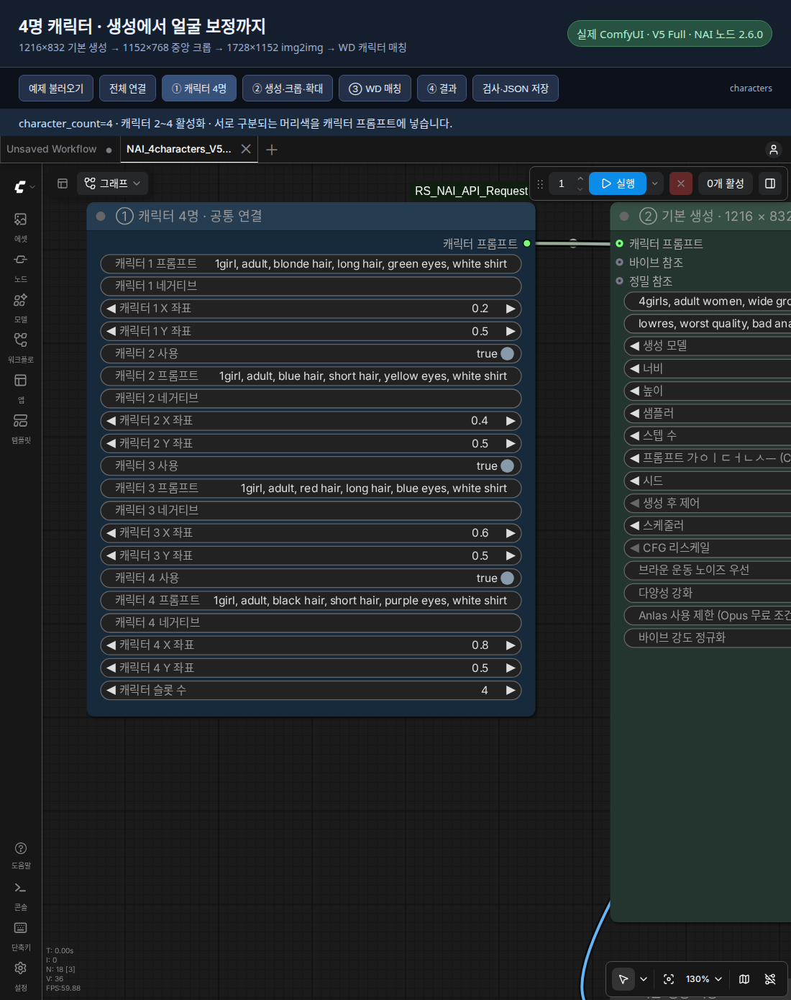
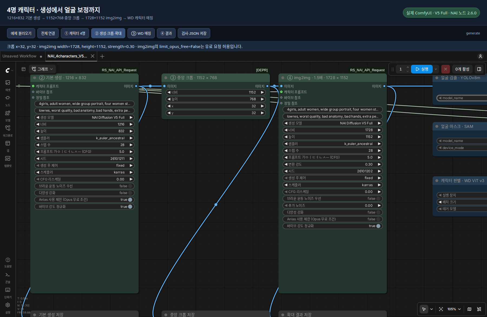
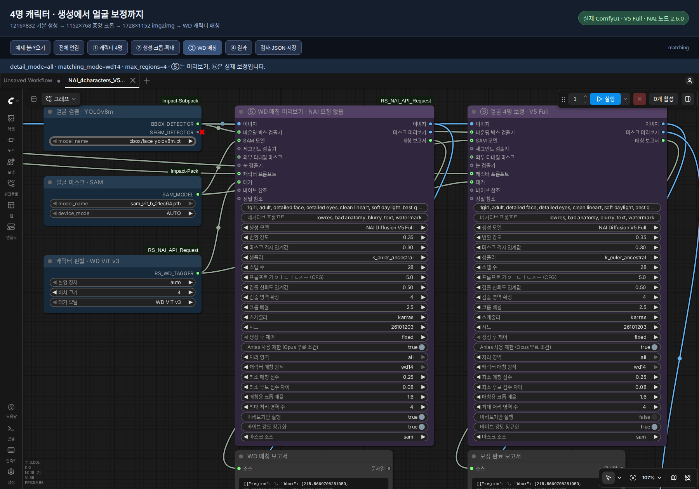
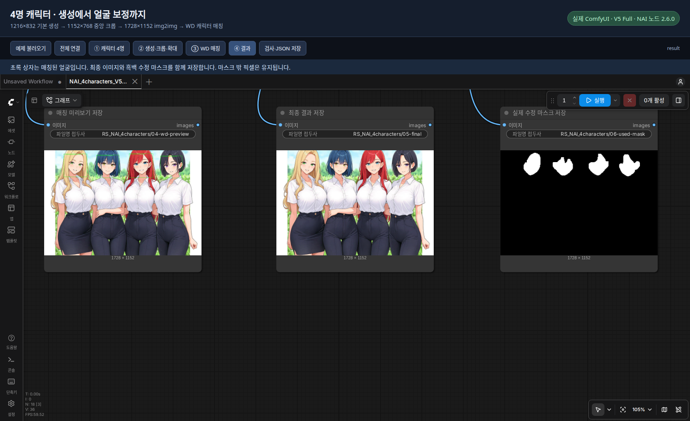
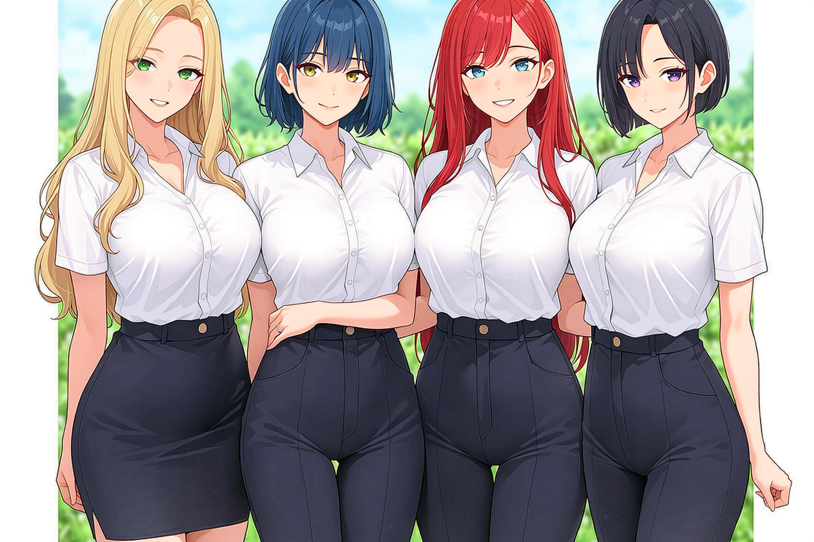

# ComfyUIでNAIのキャラクター4人を生成し、顔を補正する

[한국어](README.md) · [English](README.en.md) · **日本語**

キャラクター4人を1枚の画像に生成し、好みの比率に切り抜いてからimg2imgで1.5倍に拡大し、それぞれの顔を元のキャラクタープロンプトで補正するガイドです。付属ワークフローは接続と設定が済んでいるので、最初からノードを組む必要はありません。

実行を確認した環境は **NAIノード 2.6.0 · V5 Full · WD ViT v3** です。スクリーンショットと共有ワークフローのノードには、韓国語のカスタムタイトルが付いています。この日本語ガイドでは、手順の番号と下のノード名対応表を見ながら進めてください。自分でノードを追加する場合は、元の名前で検索できます。

**基本生成 1216×832 → 中央クロップ 1152×768 → img2img 1728×1152 → 4人の顔を補正**

## ワークフローのダウンロード

| ダウンロードするファイル | 用途 |
|---|---|
| [マッチング確認用PNG](NAI_4characters_V5_WD_preview.png?raw=true) · [JSON](NAI_4characters_V5_WD_preview.json?raw=true) | 基本生成と拡大の後、各顔とキャラクターの対応を確認 |
| [全工程実行用PNG](NAI_4characters_V5_WD.png?raw=true) · [JSON](NAI_4characters_V5_WD.json?raw=true) | 実際の顔補正と保存まで実行 |

**どちらのPNGにもComfyUIの`workflow`メタデータが入っています。** リンク先から元ファイルを保存し、ComfyUIにドラッグ＆ドロップしてください。GitHubのファイル画面が開いた場合は **Download raw file** で保存します。スクリーンショットや画像サービスの縮小版では、ワークフロー情報が失われる場合があります。JSONも同じように元ファイルを保存してください。

[Arca Liveの投稿](https://arca.live/b/aiart/185683009)では、韓国語の説明とスクリーンショットを確認できます。GitHub上ではこの文書を読み、画像の拡大表示や補正前後の比較を使いたい場合は **Code → Download ZIP** でリポジトリ全体をダウンロードして展開し、このフォルダーの`index.ja.html`を開いてください。GitHubのHTMLファイル表示画面ではガイドは動作しません。

## 0. まずはこの順番で実行

1. 下記の準備を済ませ、`NAI_4characters_V5_WD_preview.json`をComfyUIにドラッグ＆ドロップします。
2. 初回はサンプルのプロンプトとシードを変えずに実行します。WDモデルを初めて使う場合は、ダウンロード完了まで待ちます。
3. **⑤ WDマッチングプレビュー**とレポートで、4つの顔が正しいキャラクター番号に対応しているか確認します。
4. 正しければ`NAI_4characters_V5_WD.json`を読み込んで実行します。こちらは顔の補正まで進みます。
5. 結果を確認してから、キャラクタープロンプトや場面を好みに合わせて変更します。

**このサンプルにはAnlasを消費する可能性のあるimg2img工程が含まれます。** マッチング確認用ファイルも基本生成とimg2imgを実行します。2026-10-12の試験では合計18 Anlasが差し引かれましたが、固定料金ではありません。最初から何度もキューに入れず、1回ずつ結果を確認してください。

全工程実行用ファイルでは、プレビューと実際の補正が両方とも実行されます。**プレビューの承認を待って自動停止する仕組みではない**ので、初回の確認にはマッチング確認用ファイルを使ってください。

## 1. 準備と読み込み

- ComfyUIと`ComfyUI_RS_NAI_API_Request` 2.6.0以降を用意します。
- Managerから`ComfyUI-Impact-Pack`と`ComfyUI-Impact-Subpack`をインストールします。
- 顔検出モデル`face_yolov8m.pt`を`ComfyUI/models/ultralytics/bbox/`に、SAMモデル`sam_vit_b_01ec64.pth`を`ComfyUI/models/sams/`に配置します。モデル管理画面でファイル名を検索してインストールできます。
- NAIノードのフォルダーにある`.env`に自分の`NAI_ACCESS_TOKEN`を設定し、ComfyUIを再起動します。共有ファイルにトークンは含まれていません。
- タガーは`WD ViT v3`に設定済みです。初回実行時に必要なファイルがダウンロードされ、ローダーノードに進捗が表示されます。

ノードのインストールとトークン設定は[NAIノードのREADME](https://github.com/raspie10032/ComfyUI_RS_NAI_API_Request#configuration-api-token)を参照してください。タガー用の追加Pythonパッケージが不足している場合は、ノードに表示されるインストールコマンドを **ComfyUIが使っているPython環境** で実行し、再起動します。

| ファイル | 用途 |
|---|---|
| `NAI_4characters_V5_WD_preview.json` | 基本生成・拡大後、顔のマッチングまで確認 |
| `NAI_4characters_V5_WD.json` | 顔補正と保存まで全工程を実行 |
| `NAI_4characters_V5_WD.png` | 全工程用JSONと同じワークフローを含むPNG |
| `NAI_4characters_V5_WD_preview.png` | マッチング確認用JSONと同じワークフローを含むPNG |

**最初はマッチング確認用のPNGまたはJSONをComfyUIにドラッグ＆ドロップしてください。** Arca Liveで再共有する場合は、画像アップロード時の **Exifデータを保持**（`Exif 데이터 유지`）を有効にして元のPNGをアップロードします。受け取る人も画像を開き、元のPNGを保存する必要があります。ワークフローはPNGの`workflow`テキストメタデータに保存されており、同サイトのExif保持オプションでこの情報も保たれます。

| 手順 / スクリーンショット内のタイトル | 追加時に検索する元のノード名 |
|---|---|
| ① キャラクタープロンプト / 캐릭터 프롬프트 | `NAI Character Prompt Select` |
| ② 基本生成 / 기본 생성 | `NAI Image Generator` |
| ③ 中央クロップ / 중앙 크롭 | `ImageCrop` |
| ④ 1.5倍img2img / 1.5배 img2img | `NAI Img2Img` |
| 顔検出 / 얼굴 검출 | `UltralyticsDetectorProvider` |
| 顔マスク / 얼굴 마스크 | `SAMLoader` |
| キャラクター判別 / 캐릭터 판별 | `NAI WD Tagger Loader (PyTorch)` / 日本語表示: NAI タガーローダー |
| ⑤ WDマッチングプレビュー / WD 매칭 미리보기; ⑥ 顔補正 / 얼굴 보정 | `NAI Face Detailer` |

このサンプルでは **顔検出器 + SAM ViT-B** を使用します。SAM3やSEGMモデルを追加でダウンロードする必要はありません。

## 2. 4人分のキャラクタープロンプトを設定

1つのキャラクタープロンプトノードを、基本生成、img2img、2つのディテイラーに接続しています。**`character_count=4`で、キャラクター2〜4が有効（`True`）**になっています。

| キャラクター | 区別する特徴 | X / Y |
|---|---|---|
| 1 | 金髪、ロングヘア、緑の瞳 | 0.2 / 0.5 |
| 2 | 青い髪、ショートヘア、黄色の瞳 | 0.4 / 0.5 |
| 3 | 赤い髪、ロングヘア、青い瞳 | 0.6 / 0.5 |
| 4 | 黒髪、ショートヘア、紫の瞳 | 0.8 / 0.5 |

サンプルの登場人物は全員成人です。座標は基本生成時の配置のヒントです。WDマッチングは、切り出した顔のタグスコアと元のキャラクタープロンプトを比較します。髪の色など、区別しやすい特徴を記述してください。タガーが推定したタグを生成プロンプトに追加することはありません。

**共通プロンプトには場面と構図**、**キャラクタースロットには各人物の特徴**を書くと管理しやすくなります。4人分の外見を共通プロンプト1か所にまとめないようにしてください。サンプルには次のキャラクタープロンプトが保存されています。

| スロット | プロンプト |
|---|---|
| 1 | `1girl, adult, blonde hair, long hair, green eyes, white shirt` |
| 2 | `1girl, adult, blue hair, short hair, yellow eyes, white shirt` |
| 3 | `1girl, adult, red hair, long hair, blue eyes, white shirt` |
| 4 | `1girl, adult, black hair, short hair, purple eyes, white shirt` |

4人を横一列に並べる指定は共通プロンプトの`four women standing side by side in a single row`、頭が切れないようにする指定は`heads fully in frame, generous margins, all faces visible`です。プロンプト全文はJSONに保存されています。場面を変更するときは、**基本生成とimg2imgの両ノードの共通プロンプト**を確認してください。キャラクタースロットは1つのノードで共有しています。

## 3. クロップと1.5倍img2img

| 工程 | 設定 |
|---|---|
| 基本生成 | V5 Full / 1216×832 / 28 steps / CFG 5 |
| 中央クロップ | 1152×768 / X=32 / Y=32 |
| img2img | 1728×1152 / strength=0.30 / noise=0 / 28 steps / CFG 5 |

幅と高さをそれぞれ1.5倍にします。単純なリサイズではなく、NAIのimg2imgで再生成します。`strength`を高くすると、元の構図や人物が大きく変化する場合があります。

クロップでは上下左右の各辺から32ピクセルずつ切り取り、**3:2の比率**にします。端にいるキャラクターの頭や腕も切れる可能性があるため、先にクロップ結果を確認してください。その後、`1152 × 1.5 = 1728`、`768 × 1.5 = 1152`に設定します。幅と高さは各1.5倍、総ピクセル数は2.25倍になります。

**img2imgの`limit_opus_free=False`は有料リクエストを許可する設定です。** このサンプルの実行でAnlasを消費する可能性があります。基本生成とディテイラーの保護設定はTrueです。ディテイラーは保護条件を満たす小さなFocused Inpainting用クロップを使い、アカウントや設定が条件に合わない場合はブロックされます。保護を無条件に解除せず、まずエラーの案内を確認してください。

## 4. WDで顔とキャラクターを対応付ける

| 設定 | 値 / 意味 |
|---|---|
| 顔検出 | `bbox/face_yolov8m.pt` |
| マスク | `sam_vit_b_01ec64.pth`、`mask_source=sam` |
| WDモデル | `WD ViT v3` |
| `batch_size` | `4` — 一度に解析する顔クロップの枚数 |
| `detail_mode` | `all` — 最初の顔だけでなく複数領域を処理 |
| `matching_mode` | `wd14` — タガーのスコアで元のキャラクタープロンプトを選択 |
| `max_regions` | `4` — 処理する領域数の上限 |
| マッチング基準 | 最低スコア`0.25`、1位と2位のスコア差`0.08` |
| 補正強度 | `strength=0.35` |

顔検出器が位置を見つけ、SAMがマスクを作り、WDがキャラクターを選びます。`max_regions=4`にしても、必ず4つの顔が検出されるわけではありません。キャラクターを十分に判別できない顔は補正せずスキップします。

**`batch_size=4`は認識するキャラクター数ではありません。** 顔クロップを4枚ずつまとめてタガーに渡す設定です。メモリが足りない場合は1に下げても、4人分を順番に解析できます。候補となるキャラクター数は`character_count`、処理する検出領域の上限は`max_regions`で設定します。

キャラクター番号は **自分が記述したスロットの番号** です。顔領域1が必ずキャラクター1になるわけではなく、各顔のスコアからスロットを選びます。4つのスロットを1つずつ強制的に割り当てる方式でもないため、4人が意図した別々のキャラクターに対応しているか確認してください。

**最初は`NAI_4characters_V5_WD_preview.json`を実行してください。** 実際の顔補正ノードとその出力を除いたワークフローです。緑の枠とレポートでキャラクター番号を確認してから、全工程用JSONを読み込みます。全工程用JSONでは補正ノードも有効なので、1回の実行で最終補正まで進みます。プレビューが補正を自動承認・停止する接続ではありません。

プレビューディテイラー自体はNAIにリクエストしませんが、前段の基本生成やimg2imgが未実行、またはキャッシュがない場合は実行されます。**確認用ワークフロー全体が無料という意味ではありません。** 同じComfyUIセッションで入力とシードが変わらず、キャッシュが残っていれば、全工程用に切り替えた際に前段の結果を再利用できる場合があります。

設定を変更したら、全工程用ワークフローの **⑤ プレビューと⑥ 実際の補正の両方に同じ値** を設定してください。別々のノードなので自動同期はされません。確認用ファイルで変更した値が全工程用ファイルへ自動で引き継がれることもありません。

レポートでは、まず次の項目を見れば十分です。

| 項目 | 読み方 |
|---|---|
| `region` / `character` | 顔領域の番号 / 選択されたキャラクタースロット番号 |
| `score` / `margin` | マッチングスコア / 次の候補との差。正解の確率ではありません。 |
| `status: planned` | プレビューで、このキャラクターを使う予定 |
| `status: edited` | 実際の補正が完了 |
| `status: skipped` | 補正をスキップ。理由は`reason`と`explanation`で確認 |

このサンプルのSAMプレビューは **顔検出とキャラクターマッチングの確認用** です。実際のSAM編集マスクは、最終実行で保存される`06-used-mask.png`で確認してください。

## 5. 保存される結果

`ComfyUI/output/RS_NAI_4characters/`に、基本生成、クロップ、img2img、WDプレビュー、最終画像、実際の編集マスクが保存されます。このサンプルフォルダーにも、試験で得られた6枚の結果画像が入っています。

今回の試験では4つの顔がキャラクター1・2・3・4にそれぞれ対応し、全員の補正が完了しました。最終画像は **1728×1152** で、編集マスクの外側で変化したピクセルは **0個** でした。別の画像でも4人を正しく対応付けられることを保証する結果ではありません。顔の重なりや似た外見はマッチングを難しくする場合があります。

シードの制御は`fixed`で保存しています。新しい画像を作る場合は基本生成ノードのシードを変更してください。同じ設定でも、サーバー側のモデル変更などで完全に同じ結果にならない場合があります。

試験日: 2026-10-12（韓国標準時）。構図調整用の基本生成1回も含め、確認した合計消費は **18 Anlas** でした。img2imgで18、その他の工程で0でしたが、アカウントや条件によって料金は変わります。

## 6. 困ったときの確認項目

| 症状 | 最初に確認すること |
|---|---|
| 赤いノードや不明なノードが出る | NAIノード、Impact Pack、Impact Subpackの導入を確認し、ComfyUIを再起動します。 |
| 顔検出モデルやSAMモデルが一覧にない | ファイル名と上記のモデル配置先を確認し、再起動して選び直します。 |
| タガーのダウンロードに時間がかかる | ローダーの進捗を確認します。パッケージ不足やダウンロードエラーは、ノードの具体的な案内に従ってください。 |
| タガーでメモリ不足になる | `batch_size`を1に下げます。必要ならタガーの実行デバイスを`cpu`に変更します。CPU推論は遅くなる場合があります。 |
| 顔が3つしか検出されない | img2img結果で、隠れた顔、小さな顔、切れた頭がないか確認します。`max_regions`を増やしても未検出の顔は増えません。 |
| 顔は4つあるのにキャラクターが混ざる | 髪色などの区別できる特徴と`characterPrompts`の接続を確認します。マッチング用クロップに隣の人物が入っていないかも確認します。 |
| `skipped`と表示される | まずレポートの理由を読みます。いきなりしきい値を下げると、違うキャラクターで補正する場合があります。 |
| プレビューと実際の補正で対応が違う | 両ディテイラーの画像・キャラクター・タガー接続と、マッチング設定を揃えてください。 |
| 補正で顔が変わりすぎる | 実際の補正ノードの`strength`を下げます。共通の補正プロンプトに別の人物の特徴が入っていないかも確認します。 |
| Anlas保護エラーで停止する | どの工程がブロックされたか確認します。このサンプルではimg2imgだけ保護を解除し、他のノードは保護を有効にしています。 |
| PNGを置いてもワークフローが開かない | 掲示板や画像サービスがメタデータを削除した可能性があります。同梱のJSONを使ってください。 |

作成済みの拡大画像で **マッチングだけを再確認** する場合は、保存された`03-img2img`画像を`Load Image`で読み込み、**プレビューディテイラーのimage入力だけに接続した別ワークフロー**を使います。キャラクタースロット、検出器、タガーは維持し、実行する出力はプレビュー側だけにしてください。基本生成や実際の補正に接続した保存ノードを残すと、そちらも実行される場合があります。

## 7. 共有するファイル

ワークフローのPNG・JSON、実行結果、このガイドをまとめて共有してください。**リポジトリのZIPを展開して`examples/four-character-v5-wd/index.ja.html`を開くと**、専用ビューアーをインストールせずにスクリーンショットを拡大して読めます。HTMLだけを移すと画像が表示されないので、`four-character-v5-wd`フォルダーごと保管してください。

- **投稿本文:** `README.ja.md` — 掲示板のエディターに移し、対応する位置にスクリーンショットを添付します。
- **スクリーンショット5枚:** `screenshots/01`全体 → `02`キャラクター → `03`クロップ・拡大 → `04`WD設定 → `05`出力の順です。
- **主な結果画像:** `04-wd-preview.png`と`05-final.png`で、マッチングと最終結果を示します。
- **添付ファイル:** 全工程用とマッチング確認用のPNG各1枚、および対応するJSON各1個。PNGのアップロード時はメタデータを保持してください。

共有ファイルにトークンや`.env`を含めないでください。モデルの重みは同梱しておらず、利用者が自分の環境に用意する構成です。
